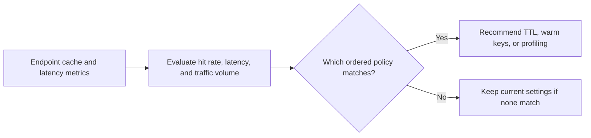

# Inference Cache Hit Rate Advisor

Recommends cache tuning actions for model-serving endpoints based on hit rate, latency, and traffic volume.

Focus: inference platform, latency SLOs, cache reliability, AI serving cost.

Portfolio framing: Apple-scale client-style AI platform project using synthetic data only.

## Run

```bash
python3 cache_advisor.py sample_cache.csv
```

## Verify

```bash
python3 -m unittest discover . -v
```

## Local verification

Run `make verify` with Make and Python 3 installed. The target runs the documented sample through the project CLI. It also runs the existing Python unit tests.

## Business problem

High inference latency can have different causes. Operators need to decide whether cache misses, traffic, or model latency deserve the first investigation.

## Project walkthrough



[Architecture and data flow](docs/ARCHITECTURE.md) · [Business problem, demo, and verification](docs/CASE_STUDY.md)
