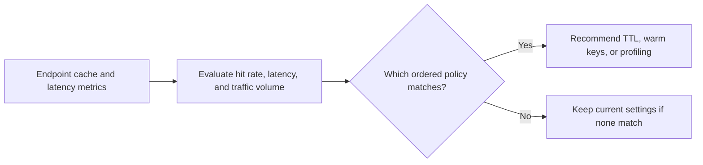

# Inference Cache Hit Rate Advisor

High inference latency can have different causes. Operators need to decide whether cache misses, traffic, or model latency deserve the first investigation.

## What I built

I built an ordered recommendation policy for inference endpoints. It considers cache hit rate, p95 latency, and request volume before suggesting TTL and precomputation changes, wider key warming, latency profiling, or no change.

## How it works



[Architecture](docs/ARCHITECTURE.md) · [Decision rules and source](docs/RULES.md)

## Tools used

| Tool | Role in this repository |
| --- | --- |
| Python | [cache_advisor.py](cache_advisor.py) implements the CLI and decision rules. Uses `csv` to read tabular exports. |
| Make | Runs the documented example and the local `unittest` suite. |
| Python replay runner | Compares actual stdout with the checked-in baseline fixtures. |
| Ruff and Bandit | Developer lint and static security checks through `make check`. |

## Run the project

Use Python 3.10+ and Make. From the repository root:

```sh
python3 cache_advisor.py sample_cache.csv
```

The recommendations endpoint receives the TTL and precomputation suggestion. The other two fixture endpoints are healthy. [Full expected output](examples/Demo%201.stdout.txt)

### Additional replay cases

- **Last sample record in isolation** · `python3 cache_advisor.py examples/last-record.csv` · [Expected output](examples/Last%20sample%20record%20in%20isolation.stdout.txt)

## Verify the project

```sh
make verify
make replay
```

`make replay` checks the recorded cases and exits nonzero if the output changes.
See the [developer guide](docs/DEVELOPMENT.md) for the pinned lint and security tools.

## Operating limits

Validate TTL changes against feature freshness, invalidation behavior, and memory before applying them. The advisor changes no cache settings.

[Case study](docs/CASE_STUDY.md) · [Operator runbook](docs/RUNBOOK.md) · [Verification report](reports/verification.md)
